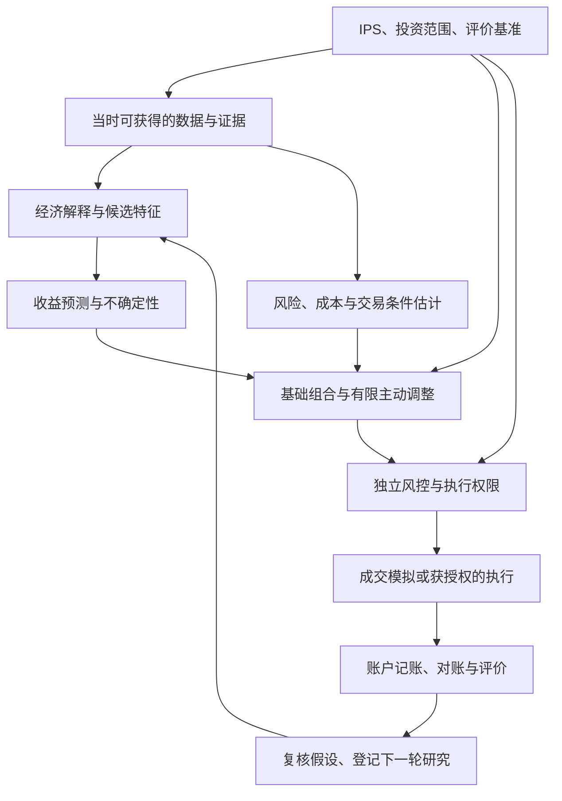

# 理论职责与系统架构

记录日期：2026-10-15。

本文记录讨论形成的理论分工、模块关系与采用顺序。具体账户政策、实验常量和数据审计结果由对应项目文档维护；本文不另行设定投资比例或交易授权。当前尚未完成系统实现或回测，以下方法的成熟程度不构成本项目能够盈利的证据。

## 1. 理论要解决什么问题

本项目希望用成熟方法跨越专业门槛，形成能够解释、计算、验证和复盘的个人金融助手。研究目标是：在预先约定的相近风险下，争取取得优于简单可投资组合的成本后收益。

需要分别回答两个问题：

1. **有没有值得采用的判断？** 信息或模型能否对未来收益、风险提供可验证的增量认识。
2. **怎样合理使用这个判断？** 在不确定性、交易成本、资金和风险约束下，怎样形成组合与行动。

组合理论主要帮助第二个问题；它不能自动解决第一个问题。优化器能够求解一个数学问题，不代表其中的收益预测已经可靠。

## 2. 成熟理论的职责

| 方法或框架 | 金融含义 | 本项目中的职责 | 不能由它保证的事情 |
| --- | --- | --- | --- |
| 投资政策书（IPS）与评价基准 | 事先约定目的、范围、风险边界及评价方法 | 约束研究、组合和执行；区分用户偏好与模型参数 | 不能由模型替用户决定风险偏好，也不能保证回撤不越过行动阈值 |
| 决策理论与期望效用 | 同时考虑结果的概率及用户对不同结果的重视程度 | 评价长期财富结果及风险，而不只看预测准确率 | 不能保证概率估计正确；一个回撤容忍数字不能唯一确定风险偏好函数 |
| 经济解释、估值与因子研究 | 提出为什么某种信息可能影响价格、收益或风险的机制 | 选择少量候选特征，写出支持理由与可能失效的条件 | 合理的故事不等于已经证明的交易优势 |
| 简单统计预测、正则化与预测收缩 | 从历史样本估计关系，并抑制对有限样本的过度信任 | 形成收益预测及误差估计；证据不足时减少主动判断 | 不能保证历史关系在未来继续成立 |
| 均值—方差组合理论 | 将收益、波动及资产共同涨跌放在一个组合问题中 | 从单个资产判断形成整体持仓；同时检查基准偏离与账户风险 | 方差不能完整描述尾部、流动性和回撤风险；输入误差会传入结果 |
| 协方差收缩估计 | 在样本估计和较稳定结构之间折中 | 改善组合风险估计的稳定性 | 不能保证相关性在压力时期不变，也不会自行产生收益预测能力 |
| 核心—卫星组织方式 | 将基础配置与主动研究部分分别管理 | 分开安排资本、职责、验收和扩展条件 | 不是独立的超额收益理论；基础部分不必然低风险，主动部分不必然赚钱 |
| Black–Litterman 观点融合 | 在明确的初始判断及不确定性模型下融合投资观点 | 后续确实需要融合多个可靠观点时再评估 | 不能把语言模型自报的信心直接当作统计置信程度 |

决策理论可参考 [William F. Sharpe 的《Expected Utility Asset Allocation》作者公开稿](https://web.stanford.edu/~wfsharpe/art/euaarevised.pdf)。组合理论的基础参考为 [Harry Markowitz 的《Portfolio Selection》原文](https://traders.berkeley.edu/papers/Markowitz.pdf)。本项目对这些理论的具体用法属于设计选择，需要用本项目数据验证。

协方差估计参考 [Ledoit 与 Wolf 的《Honey, I Shrunk the Sample Covariance Matrix》公开稿](https://econ-papers.upf.edu/papers/691.pdf)。该文的研究包含人为构造的预测信号，不能把其中组合结果解释为作者已经提供了可直接套用的真实选股预测器。

核心—卫星可参考 [Vanguard 的公开实践说明](https://fund-docs.vanguard.com/AU-Investor_guide-Vanguard_Core-Satellite_Model_Portfolios_with_LIS.pdf)，借用的是职责分工，不照搬其中产品或配比。Black–Litterman 的出处包括 [Black 与 Litterman 的原始论文条目](https://www.tandfonline.com/doi/abs/10.2469/faj.v48.n5.28)及[模型开发机构高盛的公开说明](https://www.goldmansachs.com/our-firm/history/moments/1990-black-litterman-model)。原始方法具有市场均衡等假设，不能仅因项目使用 ETF 作为基准，就把任意“ETF 基准加观点”称为原版 Black–Litterman。

## 3. 模块关系：预测与风险并行

这是逻辑模块划分，不要求第一版拆成微服务。预测模块和风险模块均以当时可得的数据为输入，分别向组合模块提供结果。风险模型不必等待语言模型形成“看涨或看跌”的判断。

反馈进入研究流程：保留旧版本，区分数据问题、执行问题、假设失效和预期范围内波动，再决定是否试验新方案。近期亏损不能直接触发自动改模型、改阈值或重置账户历史高水位。

## 4. 同一证据产生两类输出

信息助手与量化研究共用证据对象，但输出目的不同。

| 输出 | 用户或下游需要看到什么 |
| --- | --- |
| 人类可读 | 原始来源、关键事实、背景、关联理由、相反解释、未知事项和需要继续查证的问题 |
| 机器可读 | 对象标识、字段值、单位、报告期、首次公开时间、实际获取时间、版本、原文位置、缺失状态及处理规则 |

“机器可读”不等于由 AI 任意给新闻打一个买卖分数。应尽可能先提取事实，再由明确的计算或经过验证的模型决定其意义。每个重要字段都应能够回到原文；摘要的流畅程度不能代替证据质量。

语言模型负责检索辅助、解释、事件识别和结构化提取；数值程序负责单位转换、收益和风险计算、训练、回测以及订单数量。外部文章和公告是待分析的数据，不是能够修改系统权限的指令。

历史回测还要区分“当时已经公开”与“系统今天才下载”。当前语言模型可能知道历史事件的后续结果，仅限制输入日期不能完全排除这种记忆。第一版文本特征应尽量依赖可核对的原文事实；历史结果随后还需前瞻模拟验证。

## 5. 特征、参数与治理规则

| 概念 | 例子 | 产生或修改方式 |
| --- | --- | --- |
| 输入特征 | 收入同比、公告事件类别、过去一段时间的价格变化 | 从当时可得资料提取或计算 |
| 模型参数 | 回归系数、树模型内部结构 | 从训练数据学习 |
| 超参数 | 正则强度、回看窗口、树深度 | 在规定的训练与验证流程内选择 |
| 策略配置 | 调仓条件、预测期限、换手限制 | 研究设计预先登记，变更后重新验证 |
| 治理规则 | 允许交易范围、权限、回撤行动边界 | 按用户授权和投资政策管理，不能由模型自行放宽 |

收益预测收缩与协方差收缩是两件事。前者减少对预测收益的过度信任；后者减少风险估计噪声。若预测的是股票相对权益基准的收益，把预测收缩到零表示“没有足够证据支持主动优势”，不表示股票价格不会变化，也不表示账户预期收益为零。

## 6. 期限、基准与风险的口径

### 6.1 三种时间不能合并

- **预测期限**：模型要解释未来多长时间的结果。第一版以60个交易日为主，20与120个交易日作为后续扩展。
- **信号更新与调仓频率**：何时重新形成判断，何时允许交易。可以持续监控、每周决策，且一次决策可以是不交易。
- **实际持有期**：由策略、交易条件及风险规则共同决定的买入至退出间隔。

三个预测期限不是三个独立样本，也不自动对应三个组合。60日或120日结果不能外推为已经验证了几年期投资。不同期限的收益、协方差和成本必须采用相容口径，不能把60日收益预测直接与未经换算的年度风险量混在一起。

滚动训练只能使用当时已经观察到完整结果的标签；预测120日结果的样本，在120日观察窗口尚未结束时不能进入训练。预处理与模型选择也须遵守各自的时间边界。

### 6.2 权益预测基准与账户评价基准分别记录

股票预测可以使用510300这样的权益工具作为相对收益参照：

\[
y_{i,t,H}=R_{i,t\rightarrow t+H}-R_{B_{\mathrm{equity}},t\rightarrow t+H}
\]

这叫基准相对收益。正值可以出现在股票和基准都下跌的时期，不能直接称为已经识别出的 alpha。

完整账户的评价则使用项目约定的基础组合及再平衡规则，例如已接受的80%权益、20%系统现金研究基准。股票相对权益 ETF 的预测结果，不能直接当作账户相对这个80/20组合的最终表现。

### 6.3 基础配置、主动风险与绝对账户风险

可以把组合表达为“基准权重加主动偏离”。主动风险衡量偏离基准的程度；绝对账户风险还包含基础组合自身的市场风险。跟踪误差小，并不意味着账户不会明显下跌。

ETF 与个股也不是天然互补。直接持股与 ETF 内部对应持仓应合并检查公司和行业暴露；账户记账时不能把 ETF 市值和它的底层股票再加一次。使用滞后的公开持仓或指数权重代理时，应说明估计误差，不能声称掌握每日真实完整持仓。

## 7. 第一版保留完整链路，简化模型复杂度

采用顺序如下：

1. **固定政策和实验问题。** 明确范围、基准、主要期限、成本口径、时间切分与评价方法。
2. **让数据和账本可信。** 保存原始证据与版本，处理交易状态、分红和缺失数据，能够追溯每次模拟交易。
3. **建立简单预测基线。** 使用少量有经济解释的特征和带正则化的线性模型，评估误差及稳定性。
4. **同时建立风险与成本估计。** 检查相关性、集中度、换手及可交易性，使预测不能绕过组合约束。
5. **用透明规则形成有限主动调整。** 证据不足或约束不满足时，允许保持基础组合或不交易；第一版不必求解复杂动态最优配置。
6. **逐项比较新增能力。** 保留简单基准、数值模型、数值加文本模型三组，按共同条件评价增量贡献。
7. **通过模拟和运行检查后，再讨论扩大职责。** 小额执行验证与标准虚拟研究账户分层，不能因小额订单粒度而放宽个股集中度要求。

研究流程的模块化和实验记录可参考 [Microsoft Qlib 官方研究工作流文档](https://qlib.readthedocs.io/en/stable/component/workflow.html)。历史与实时共用策略核心、分别处理数据和成交适配器的设计可参考 [LEAN 引擎官方说明](https://www.quantconnect.com/docs/v2/writing-algorithms/key-concepts/algorithm-engine)。这些是架构参照，不是已经确定的技术选型或数据质量背书。

## 8. 后置能力及进入条件

| 后置能力 | 为什么暂缓 | 何时值得加入 |
| --- | --- | --- |
| 梯度提升树等更复杂预测模型 | 先确定数据和简单基线是否可信 | 通过相同验证流程，证明存在稳定增量 |
| 完整 DCF 估值模型 | 需要较多经营、折现和终值假设 | 数据足够，且能明确区分情景假设与可观察事实 |
| Black–Litterman | 需要明确先验、观点与不确定性来源 | 多来源观点确实需要融合，且可以校准误差 |
| 动态资本分配、多策略优化 | 会同时增加参数、反馈路径和验证难度 | 单个策略已形成可解释的样本外记录 |
| 广泛新闻、多代理讨论、复杂知识图谱 | 容易先扩大信息量，后补质量控制 | 窄范围信息闭环已证明准确且有用 |
| 自动模型更新和实盘执行 | 涉及版本治理、权限和运行可靠性 | 模拟、对账、异常处理及授权条件分别通过检查 |

完整 DCF 可以先作为理解企业与比较情景的工具；它的估值差异不自动等于短期价格会回归。中期与长期策略未来可以共享数据，但应有独立目标与研究记录，再由统一组合层管理资本和风险。

## 9. 优先防止的架构错误

1. 把预测得分直接当作仓位，跳过误差、成本和账户约束。
2. 把股票加 ETF 当作已经分散风险，或把低主动风险当成低账户风险。
3. 把一次回测领先当作验证完成，忽略未来数据、重叠标签和反复挑选结果。
4. 把复杂理论堆在一起，同时改变特征、模型和交易规则，导致无法判断改进来自哪里。

具体的“公告事实—数学特征—预测—组合”教学过程见[美的2024年报示例](examples/MIDEA_2024_REPORT.md)。
